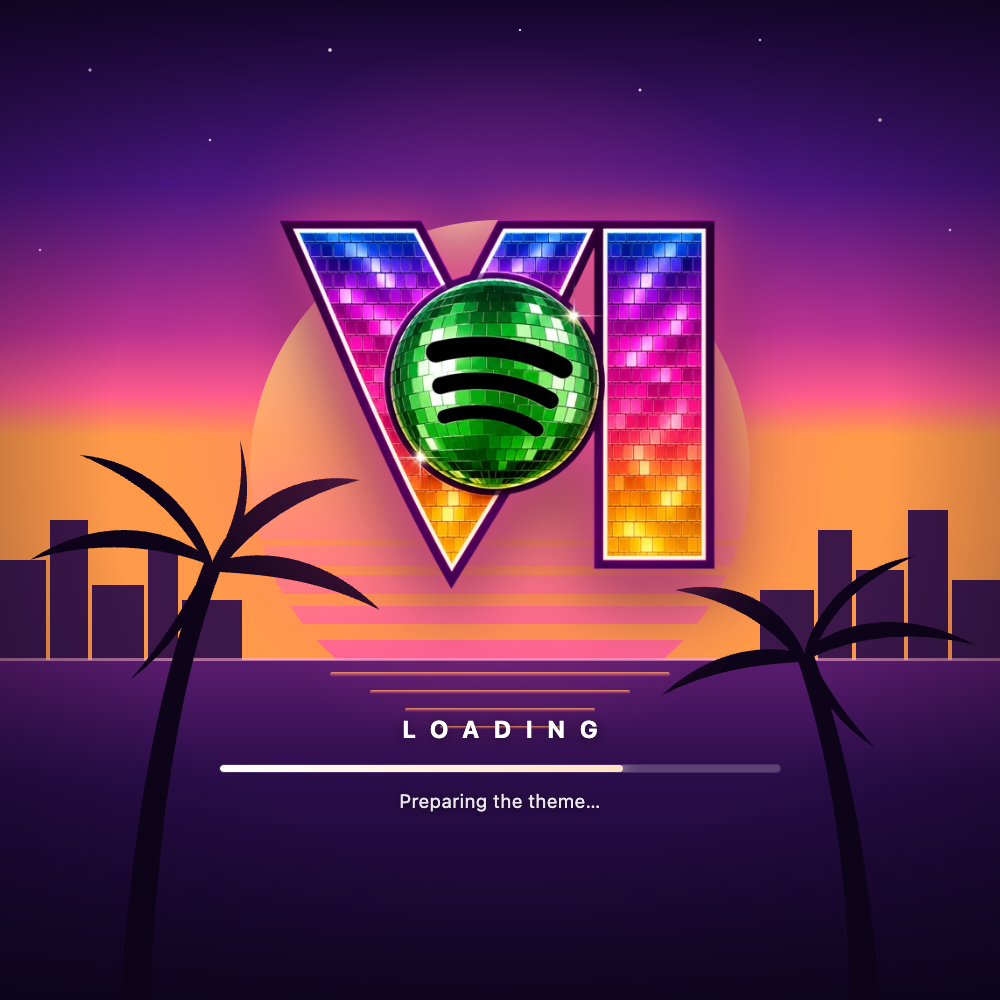

# GTA6 — Spicetify theme

A "Vice City" liquid-glass theme for Spotify: tinted glass panels over GTA VI artwork, accent colors that follow the current cover art, an animated loading screen and animated player controls.



*[Version française plus bas ↓](#version-française)*

## Features

- **Glass panels**: tinted glass with highlights, glowing edges and rounded corners.
- **Cover-based colors**: the theme accent changes with every track.
- **Animated loading screen** while Spotify starts.
- **Animated player controls**: gradient ring around play/pause while music is playing, glass bubbles on hover for previous / next / shuffle / repeat.
- **Apple system font** (SF Pro) on macOS.
- **Performance first**: animations use only `transform` / `opacity`, no real-time blur, animations start after loading and pause when Spotify is in the background. Respects the system "Reduce motion" and "Reduce transparency" settings.

## Requirements and disclaimers

- **[Spicetify](https://spicetify.app) is required.** This theme only works with the Spotify **desktop** app (macOS, Windows, Linux), not the web player or mobile.
- Spicetify **modifies the Spotify client in an unofficial way**. It is not supported or endorsed by Spotify: use at your own risk. A Spotify update can break the theme until it is updated.
- Fan project, **not affiliated** with Rockstar Games, Take-Two Interactive or Spotify. "GTA", "Grand Theft Auto", "Rockstar Games" and "Spotify" are trademarks of their respective owners.
- The background and loading-screen artwork belong to **Rockstar Games**. They are **not stored in this repository**: the theme loads them from Rockstar's website. If Rockstar changes those addresses, a fallback gradient is shown instead.
- The first launch downloads about 2.6 MB of images (then cached by Spotify).

## Installation

### Quick install (recommended: instant loading screen)

One command installs the theme directly into Spotify (run it again to update):

macOS / Linux:

```bash
curl -fsSL https://gregjvdr.github.io/spicetify-gta6/install.sh | sh
```

Windows (PowerShell):

```powershell
iwr -useb https://gregjvdr.github.io/spicetify-gta6/install.ps1 | iex
```

Requires `git`. If a `GTA6` folder that was not created by this script already exists in your Spicetify themes folder, the script stops without touching it.

### From the Spicetify Marketplace

1. Install the [Spicetify Marketplace](https://github.com/spicetify/marketplace) if you haven't already.
2. In Spotify, open **Marketplace** → **Themes** tab.
3. Search for **GTA6** and click **Install**. Restart Spotify once to see the loading screen.

> With the Marketplace, Spotify may show up for a split second before the loading screen: the Marketplace downloads the theme on every launch, after Spotify has started. The quick or manual install does not have this delay.

### Manual install

```bash
# 1. Clone the theme into the Spicetify themes folder
git clone https://github.com/GregJVDR/spicetify-gta6.git "$(dirname "$(spicetify -c)")/Themes/GTA6"

# 2. Enable the theme, its color scheme and its JavaScript
spicetify config current_theme GTA6 color_scheme vice inject_theme_js 1 inject_css 1 replace_colors 1

# 3. Apply
spicetify apply
```

On Windows (PowerShell), replace the first command with:

```powershell
git clone https://github.com/GregJVDR/spicetify-gta6.git "$(Split-Path (spicetify -c))\Themes\GTA6"
```

## Customization

The **RÉGLAGES** (settings) section at the top of `user.css` lets you change:

- `--verre-teinte`: glass opacity (last number: `0` transparent → `1` opaque);
- `--assombrir-fond`: background image darkening;
- `--intensite-aurore`: strength of the cover-art tint on the background.

**Use your own background**: replace the `--fond` address (and `--splash` for the loading screen) on the third line of `user.css` with the URL of your image.

## After a Spotify update

Spotify updates remove Spicetify's changes (this applies to every Spicetify theme). Run `spicetify backup apply` to restore them.

## Uninstall

Marketplace: **Remove** button on the theme card. Manual / quick install:

```bash
spicetify config current_theme "" color_scheme ""
spicetify apply
```

## License

Code under the [MIT](LICENSE) license. The license covers neither Rockstar Games' artwork nor the trademarks mentioned above.

---

## Version française

Thème Spotify « Vice City » au style *liquid glass* : panneaux en verre teinté sur une illustration GTA VI, couleurs qui suivent la pochette en cours, écran de chargement animé et boutons du lecteur animés.

### Fonctionnalités

- **Panneaux en verre** teinté, reflets, bords lumineux et coins arrondis.
- **Couleurs selon la pochette** : l'accent du thème change à chaque morceau.
- **Écran de chargement animé** pendant le démarrage de Spotify.
- **Boutons du lecteur animés** : anneau dégradé autour de lecture/pause pendant la lecture, bulles de verre au survol de précédent / suivant / aléatoire / répéter.
- **Police système Apple** (SF Pro) sur macOS.
- **Performances avant tout** : animations uniquement en `transform` / `opacity`, aucun flou en temps réel, animations lancées après le chargement et mises en pause quand Spotify est en arrière-plan. Respecte « Réduire les animations » et « Réduire la transparence » du système.

### Prérequis et avertissements

- **[Spicetify](https://spicetify.app) est obligatoire.** Le thème ne fonctionne qu'avec l'application Spotify **de bureau** (macOS, Windows, Linux), pas sur le lecteur web ni sur mobile.
- Spicetify **modifie le client Spotify de façon non officielle**. Ce n'est ni soutenu ni approuvé par Spotify : utilisation à vos risques. Une mise à jour de Spotify peut casser le thème jusqu'à sa mise à jour.
- Projet de fans, **non affilié** à Rockstar Games, Take-Two Interactive ou Spotify. « GTA », « Grand Theft Auto », « Rockstar Games » et « Spotify » sont des marques de leurs propriétaires respectifs.
- Les illustrations du fond et de l'écran de chargement appartiennent à **Rockstar Games**. Elles ne sont **pas stockées dans ce dépôt** : le thème les charge depuis le site de Rockstar. Si Rockstar change ces adresses, un dégradé de secours s'affiche à la place.
- Le premier lancement télécharge environ 2,6 Mo d'images (mises ensuite en cache par Spotify).

### Installation

**Installation rapide (recommandée : écran de chargement instantané)** — une seule commande installe le thème dans Spotify (relancez-la pour mettre à jour) :

```bash
# macOS / Linux
curl -fsSL https://gregjvdr.github.io/spicetify-gta6/install.sh | sh
```

```powershell
# Windows (PowerShell)
iwr -useb https://gregjvdr.github.io/spicetify-gta6/install.ps1 | iex
```

Nécessite `git`. Si un dossier `GTA6` qui ne vient pas de ce script existe déjà dans vos thèmes Spicetify, le script s'arrête sans y toucher.

**Depuis le Marketplace Spicetify** : **Marketplace** → onglet **Themes** → cherchez **GTA6** → **Install**, puis relancez Spotify une fois pour voir l'écran de chargement.

> Avec le Marketplace, Spotify peut apparaître une fraction de seconde avant l'écran de chargement : le Marketplace télécharge le thème à chaque lancement, après le démarrage de Spotify. L'installation rapide ou manuelle n'a pas ce délai.

**Installation manuelle** : voir les commandes de la section *Manual install* ci-dessus (identiques).

### Personnalisation

En haut de `user.css`, la section **RÉGLAGES** permet de changer `--verre-teinte` (opacité du verre), `--assombrir-fond` (assombrissement du fond) et `--intensite-aurore` (teinte de pochette sur le fond).

**Mettre votre propre fond** : remplacez l'adresse de `--fond` (et `--splash` pour l'écran de chargement) sur la troisième ligne de `user.css` par l'URL de votre image.

### Après une mise à jour de Spotify

Les mises à jour de Spotify effacent les modifications de Spicetify (c'est vrai pour tous les thèmes). Lancez `spicetify backup apply` pour les remettre.

### Désinstallation

Marketplace : bouton **Remove** sur la carte du thème. Installation manuelle ou rapide :

```bash
spicetify config current_theme "" color_scheme ""
spicetify apply
```

### Licence

Code sous licence [MIT](LICENSE). La licence ne couvre ni les illustrations de Rockstar Games ni les marques citées.
